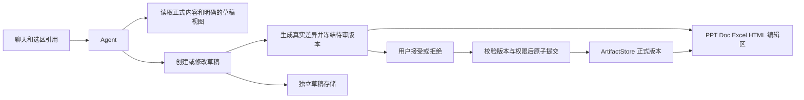

# Reizo 平级工作区与文档修订方案调研

调研日期：2026 年 10 月 8 日。范围包括 desktop、winlume 的现有实现，PPT、Doc、Excel、HTML 开源编辑器，以及 agent 修改后的审核、版本保护和 Office 文件导入导出。

建议把画布和四类编辑区做成平级入口，复用现有产物存储，并在编辑器与 agent 之间增加独立的草稿和审核服务。Excel 优先迁移 winlume；HTML 先做源码编辑与预览；Doc 同时验证 Tiptap 的开放式实现和原生 DOCX 编辑器；PPT 单独验证元素编辑与 PPTX 往返。决定 Doc 选型的主要条件是：用户是否需要把未决修订导出到 Word 中继续审核。

本报告区分三类证据：项目代码中的现状、上游官方文档描述的能力、隔离探针实际验证的结果。编辑器的完整文件兼容性按下面的样本矩阵验收，不能由 README 或几个简单示例推定。

**需要分别解决编辑、差异展示和审核提交。**

| 能力 | 用户获得什么 | 本身不能保证什么 |
| --- | --- | --- |
| 编辑器 | 修改文字、表格、图片、公式或幻灯片元素 | 不保证 agent 的程序化修改被追踪 |
| Diff | 看到修改前后内容、格式或布局的差异 | 不保证修改尚未写入正式内容 |
| 建议和修订 | 逐项接受或拒绝，保留修改来源 | 不保证所有结构和属性变化都受支持 |
| 版本历史 | 回看或恢复历史版本 | 不等于改动发生前的审核；整版恢复会替换后续内容 |
| 原生 Word 修订 | 在 DOCX 中保留作者、修改和审核状态 | 不由 HTML 中的红绿标记自动获得 |
| 草稿提交服务 | 正式内容只接收用户授权的具体修改 | 仍需各编辑器提供可靠的读取、修改和验证能力 |

用户担心 AI 不知情改动，核心承诺应是“用户审核前，正式内容不变”。草稿可以持续保存、渲染和被 agent 检查。对于新建文档，可以直接生成一个可编辑草稿；对于已有文档，默认创建修改建议。这两个动作都应在界面中明确显示。

**两个项目已经有可复用的基础。**

| 位置 | 现状 | 建议复用或补齐 |
| --- | --- | --- |
| desktop `RightPanel` 和 `uiStore` | 画布、作品、文件、Git、终端已有平级面板机制 | 添加 PPT、Doc、Excel、HTML 入口，按产物类型筛选和打开编辑区 |
| desktop `ArtifactStore` | SQLite 元数据、文本或二进制内容、版本、内容 digest、来源记录 | 作为正式版本存储；新增草稿、建议、决策和提交记录 |
| desktop `ArtifactVersionRail` | 历史版本选择和恢复 | 保留历史功能；不要把版本回滚等同于逐项拒绝 AI 建议 |
| desktop `artifactTools` | 已有 `generate_sheet` 和局部表格操作 | 扩展读取选区与提出修改；审核模式下写入草稿 |
| desktop `DiffView` | 使用 `@pierre/diffs` 展示文件前后内容 | 复用于 HTML/CSS/JS 源码；文档正文增加富文本差异视图 |
| desktop `presentationExport` | 每页图片被放入 PPTX | 继续用于图片演示稿；可编辑的标题、表格、图表需要元素模型 |
| desktop HTML renderer | `sandbox=""` 的静态 iframe 预览 | 补源码编辑、选区引用，以及受隔离的运行预览 |

代码入口：[RightPanel](../src/renderer/components/workspace/RightPanel.tsx)、[产物类型](../src/shared/artifact.ts)、[ArtifactStore](../src/main/server/storage/artifactStore.ts)、[版本历史](../src/renderer/components/workspace/ArtifactVersionRail.tsx)、[表格工具](../src/main/server/agent/artifactTools.ts)、[代码差异视图](../src/renderer/components/chat/DiffView.tsx)、[PPT 导出](../src/main/server/canvas/presentationExport.ts)、[HTML 预览](../src/renderer/components/workspace/renderers/index.tsx)。

当前 `addVersion` 会推进正式产物的 `current_version`；通用版本写入路由没有接收用户审核的具体修改集合。因此不能把 AI 的建议版本直接写入这条路径，再依靠红绿标记表示“尚未接受”。草稿需要自己的身份和状态，接受后才产生正式版本。现有字段和方法还需要加入提交时的版本校验。

此外，agent 的 `write_file` 路径会通过 `onFileWritten` 自动创建或追加产物版本。同名文件再次写入也会推进已有产物。新增审核模式时，结构化编辑工具、通用文件写入、命令行回写和导入替换必须遵循同一规则；只在 Doc 工具的 prompt 中写“不要直接修改”不能兑现这一承诺。[运行时写入钩子](../src/main/server/agent/runtime.ts)、[工作区工具](../src/main/server/agent/workspaceTools.ts)。

**winlume 的 Excel 交互应作为第一轮迁移对象。**

| 已有能力 | 代码位置 | 迁移价值 |
| --- | --- | --- |
| 工作表选区广播 | `SheetEditor.tsx`、`sheet-selection.ts` | 用户选中单元格后，输入框引用正确的工作簿、工作表和 A1 范围 |
| 固定引用及发送时携带选区 | `Composer.tsx` | “修改这里”能落到具体范围 |
| 发送前保存 | `sheet-flush.ts`、`StudioSessionView.tsx` | agent 读取用户最新单元格修改 |
| 当前工作簿摘要 | `sheet-summary.ts`、`runtime.ts` | 避免 agent 对旧表格执行修改 |
| 局部操作 | `tools/execute.ts`、`sheet-content.ts` | 写值、公式、清空范围及工作表管理 |
| XLSX 导入导出 | `sheet-xlsx.ts`、`upload-sheet/route.ts` | 数值、公式和常见样式、合并单元格、行列尺寸转换 |
| 更新与重建 | `ArtifactPreview.tsx` | agent 更新后按 revision 重建；用户自动保存避免反复重建 |
| 保存版本检查 | `api/artifacts/[id]/route.ts` | 检测部分陈旧写入，作为后续提交校验的参考 |

两项目的 Univer 依赖均为 `0.25.1`，ExcelJS 均为 `4.4.0`。迁移核心模型、导入导出和选区逻辑后，把 Next.js 路由接到 desktop 的 Hono 和本地存储；不要直接迁移整个 Studio 组件树。

winlume 的边界也需要保留：最多 8 张工作表、2000 行、50 列和 40000 个网格单元格；模型摘要默认展示最多 80 行、20 列。导入截断标记要显示给用户，大表应支持按选区读取。这里的常见样式映射不等于完整 Excel 格式保留，宏、复杂图表、透视表等需要独立样本验证。

desktop 目前的 XLSX 导出只写紧凑模型的单元格值和公式，没有读取 Univer snapshot 中的格式；普通上传又会把识别为 sheet 的文件按文本读取。因此 XLSX 二进制导入和样式导出都值得直接复用 winlume。[当前 XLSX 导出](../src/shared/sheetXlsx.ts)、[当前普通上传](../src/renderer/components/workspace/ArtifactPanel.tsx)。

**Doc 有两条不同的产品路线。**

| 需求 | 更适合的路线 | 主要成本 |
| --- | --- | --- |
| agent 生成报告、方案、笔记，用户选段润色 | Tiptap 等 Web 富文本模型 | 建议审核、导出转换和自己的工具接口 |
| 导入客户已有 Word 文件，保留复杂结构、批注和修订 | 原生 DOCX 模型，例如 SuperDoc、EigenPal，或完整 Office 服务 | 格式兼容、授权、引擎集成和回写验证 |
| 三种 Office 文件都强调已有文件兼容 | ONLYOFFICE 或 Collabora 路线 | 额外服务、文件回调、插件或自动化桥接、桌面部署 |

Tiptap JSON 适合自己生成的内容。对于复杂已有 DOCX，先转成 HTML 再编辑会改变可表达的结构；后续重新生成 DOCX 不能自动恢复转换时丢失的对象。原生 DOCX 编辑器的“保留未知 OOXML”也不等于“完整显示或编辑未知对象”，应分别检验读取、显示、修改和保存。

**文档编辑器和修订实现的候选清单。**

| 候选 | 核心许可证 | 修订与 agent 能力 | 对 Reizo 的判断 |
| --- | --- | --- | --- |
| Tiptap Core | MIT | 开放的富文本模型和命令，可自己做 agent 工具 | 适合新建文档和应用内建议审核；完整分页和 Office 转换另算 |
| Tiptap 官方 Tracked Changes | 商业附加功能 | 可从代码提出插入、删除、替换和格式建议；文档当前标为 Alpha | 作为支持与集成成本的对照方案，不应视为稳定免费核心功能 |
| `@handlewithcare/prosemirror-suggest-changes` | MIT | 把编辑事务转换成建议，提供接受/拒绝操作 | 首选开放式建议引擎 PoC；还需 Tiptap 接入、来源元数据和范围控制 |
| `sungkhum/tiptap-track-changes` | MIT | 自带建议模式、多作者、分组及接受/拒绝 | 可参考界面和辅助函数；发布版程序化文字写入存在下面的已复现缺口 |
| `chenyuncai/tiptap-track-change-extension` | MIT | 文字增删的修订标记，接受/拒绝命令 | 较小实现，可作为参考；不能由演示推定复杂结构和 agent 事务覆盖 |
| `prosemirror-changeset` | MIT | 从编辑步骤归纳新增、删除范围 | 用于差异计算；它不是完整的审核和提交系统 |
| BlockNote | 核心 MPL-2.0；XL 功能 GPL-3.0 或商业 | React 块编辑器，AI 功能含接受/拒绝及流式反馈 | 很适合参考交互；AI 扩展处于 early preview，授权范围独立 |
| [SuperDoc](https://github.com/superdoc/docx-editor) | AGPLv3 或商业 | 原生 DOCX、同一 Document API、修订决策、比较、服务端和 MCP | 原生 Word 修订路线的优先 PoC；按能力矩阵限制操作 |
| [EigenPal DOCX Editor](https://github.com/eigenpal/docx-editor) | 核心 Apache-2.0；Pro 包独立商业许可 | React/Vue 原生 DOCX；修订和自动化 API 为 Pro | React 集成便利，必须分别核对界面和程序化修订的支持范围 |
| [CKEditor 5](https://ckeditor.com/docs/ckeditor5/latest/getting-started/licensing/license-and-legal.html) | 核心 GPL 或商业；修订为高级功能 | 完整建议界面、用户权限和协作体系 | 商业产品对照，不能作为免费修订插件选型 |

来源：[Tiptap Core](https://github.com/ueberdosis/tiptap)、[官方修订扩展](https://tiptap.dev/docs/editor/extensions/functionality/tracked-changes)、[Handle With Care](https://github.com/handlewithcarecollective/prosemirror-suggest-changes)、[sungkhum](https://github.com/sungkhum/tiptap-track-changes)、[chenyuncai](https://github.com/chenyuncai/tiptap-track-change-extension)、[changeset](https://github.com/ProseMirror/prosemirror-changeset)。

BlockNote 的 AI 扩展由 `@blocknote/xl-ai` 提供，当前官方文档标为早期预览；接受/拒绝交互可参考，但核心许可证不能代表 XL 功能的许可证。[AI 功能说明](https://www.blocknotejs.org/docs/features/ai)、[许可证区分](https://www.blocknotejs.org/pricing)。CKEditor 的修订可独立于实时协作运行，还能限定使用者只能提出建议；这些属于高级协作能力。[修订说明](https://ckeditor.com/docs/ckeditor5/latest/features/collaboration/track-changes/track-changes.html)、[协作许可说明](https://support.ckeditor.com/hc/en-us/articles/360000013420-What-are-CKEditor-5-collaboration-features)。

`prosemirror-changeset` 的默认 token 比较忽略 marks 和 attributes。只依靠默认文本范围 diff，会遗漏字体、链接目标和部分属性变化。格式和结构需要额外比较，也可定制编码；差异展示必须与实际提交的操作相对应。[上游说明](https://github.com/ProseMirror/prosemirror-changeset)。

**隔离验证证明修订模式不能代替提交保护。**

本地探针使用 Node `22.13.0`、Tiptap `3.31.4`、jsdom `26.1.0`，验证 npm 发布版 Handle With Care `0.1.8` 和 `tiptap-track-changes 0.2.1`。示例原文为“原文保持”。Handle With Care 通过公开的事务转换入口执行；另一插件通过真实 Tiptap Editor 的命令执行。

| 实际测试 | Handle With Care 0.1.8 | tiptap-track-changes 0.2.1 |
| --- | --- | --- |
| 程序替换“原文”为“修改” | 出现删除和插入标记；接受等于预期结果，拒绝恢复基线 | 待审核数为 0；全部拒绝后仍为“修改保持” |
| 程序删除“原文” | 出现删除标记；接受正确，拒绝恢复基线 | 待审核数为 0；全部拒绝后仍为“保持” |
| 程序设置粗体 | 可接受，拒绝恢复基线；本版本以删除和插入标记表达 | 出现 1 个格式建议 |
| 修改文档级 `lang` 属性 | 没有建议标记；拒绝不能恢复属性 | 本轮未覆盖 |

`tiptap-track-changes` 的文字兜底逻辑会跳过没有 `uiEvent` 或 `composition` 元数据的程序化事务；格式变化有独立处理。因此不能把“当前处于 suggest 模式”视为 agent 的 `insertContentAt` 和 `deleteRange` 已被拦截。[对应源码](https://github.com/sungkhum/tiptap-track-changes/blob/main/src/suggest-mode-plugin.ts)。

Handle With Care 也需要明确的操作允许集合，不能把未知 Step 自动视为可审核变化。npm 实际发布版为 `0.1.8`，调研时 main 的 package 版本为 `0.1.9`，两者的事务转换函数参数顺序已有差异；集成应锁定版本并使用对应类型定义。[上游源码](https://github.com/handlewithcarecollective/prosemirror-suggest-changes/blob/main/src/withSuggestChanges.ts)。

可复现材料位于 [探针目录](../artifacts/research/office-workspaces-20261008/README.md)，包括脚本和完整依赖锁。上述结果只验证列出的最小行为，中文输入法交互、真实浏览器、表格、协作和 DOCX 回写按后面的测试矩阵验收。

**原生 DOCX 路线也存在必须限制的操作。**

SuperDoc 可以对支持的变更使用 `changeMode: 'tracked'`，接受/拒绝针对逻辑修改 ID，并用 revision 校验。其比较接口先判断 `applyEligibility`；不支持的结构应拒绝应用。当前文档的比较矩阵包含正文 SDT 限制、页眉页脚拓扑限制，以及需要额外判断的图片和关系变化；矩阵还绑定具体 next 版本。生产选型要使用匹配发布版本的能力结果，不能只按接口名称认为所有 Word 对象都能比较。[修订操作](https://docs.superdoc.dev/document-api/tracked-changes/)、[比较支持矩阵](https://docs.superdoc.dev/document-api/document-comparison/)。

EigenPal 的界面建议模式明确不记录部分列表、缩进、tab stop 和表格属性改动，某些操作会直接生效且没有审核卡片。它的程序化 Editor API 又有自己的能力范围：受支持的 tracked 写入会形成原生修订，不支持的结构会拒绝。两条写入路径应分别验证，或只开放确认能审核的操作。[界面修订限制](https://www.docx-editor.dev/docs/2.x/pro/tracked-changes)、[程序化 API](https://www.docx-editor.dev/docs/2.x/editor-api)。

原生引擎的比较 payload 不一定可以永久保存。例如 SuperDoc 的 `diff.payload` 是引擎拥有的不透明数据。建议持久化基线版本、候选 DOCX、可展示的变更摘要及受支持的稳定操作描述，需要时重新生成比较结果，不把运行时 payload 当作自己的持久化格式。[比较接口说明](https://docs.superdoc.dev/document-api/document-comparison/)。

**应用内审核与 Word 原生修订应分开验收。**

| 导出模式 | 文件内容 | 建议行为 |
| --- | --- | --- |
| 导出正式版 | 只包含已经接受的修改 | 默认行为；未决建议不会悄悄并入 |
| 导出候选结果 | 包含用户明确选择导出的提议结果 | 标为候选稿，与正式版区分 |
| 导出带修订 DOCX | 包含原生插入、删除、格式等修订记录 | 只有经验证的引擎和对象类型才开放 |
| 导出审核 PDF 或 HTML | 供人阅读的前后标记 | 不表示能在 Word 中继续接受/拒绝 |

Word 的修订包含内容和属性结构，接受插入、接受删除和接受格式变化是不同操作。仅开一个 track revisions 设置，或把 `<ins>`、`<del>` 放进 HTML，不会把已有变更自动转成完整的 DOCX 修订。[Microsoft Open XML 修订处理](https://learn.microsoft.com/en-us/office/open-xml/word/how-to-accept-all-revisions-in-a-word-processing-document)。

开放式的辅助路线是 .NET 的 Open XML SDK 和 MIT 的 Open XML PowerTools `WmlComparer`：比较两份 DOCX，生成带修订的 DOCX。它可作为转换或比较 worker，不提供 React 编辑器；PowerTools 仓库还公开在寻找维护者，因此需要单独维护与样本测试。先用富文本转换丢失的格式，也不会被比较器找回。[SDK 许可](https://github.com/dotnet/Open-XML-SDK/blob/main/LICENSE)、[PowerTools](https://github.com/OpenXmlDev/Open-Xml-PowerTools)。

**PPT、Excel 和 HTML 也需要各自的修改语义。**

| 工作区 | 正常定位方式 | 审核时展示什么 | 合入粒度 |
| --- | --- | --- | --- |
| Doc | 稳定块 ID、文字范围、故事区域 | 段落内增删、格式卡片、表格和图片变化 | 一次替换或一组有依赖的结构操作 |
| Excel | 工作簿 ID、工作表 ID、A1 范围 | 旧值、新值、旧公式、新公式、格式及受影响范围 | 相关单元格组；插行与公式调整一起审核 |
| PPT | 稳定幻灯片 ID、元素 ID | 前后页缩略图、对象文字、图片、位置、层级变化 | 元素或幻灯片操作组 |
| HTML 源码 | 文件、源码范围、基线 hash | HTML/CSS/JS 文件 diff、预览前后变化 | 能独立生效的 patch 组 |
| HTML 可视化 | 持久组件 ID、组件模型路径 | 文本、样式、属性和组件树变化 | 组件模型操作组 |

Excel 不能只比较最终数值：公式由 SUM 改为写死常量，即使当时显示相同，也必须展示差异。PPT 移动元素不能显示为“没有文字变化”。HTML 的链接目标和脚本也不能只用页面截图说明。Doc 替换的删除与插入需要共享同一审核组，避免只接受一侧。

**PPT 候选和导入导出取舍。**

| 候选 | 许可证与形态 | 适合的产品目标 | 建议 |
| --- | --- | --- | --- |
| PPTist | 当前 AGPL-3.0；Vue/TypeScript 应用；可申请独立授权 | 接近 PowerPoint 的页和元素编辑 | 优先验证结构化 agent 操作与真实 PPTX；封装 Vue 子应用并明确消息协议 |
| Presenton | 仓库 Apache-2.0；完整生成与编辑应用 | AI 生成、模板、拖拽调整、可编辑 PPTX 输出 | 参考生成与模板模块，或先作为隔离服务接入 |
| Univer Slides | 当前官方 v1.0.3 文档说明 Slides 位于 `@univerjs-pro`，需按许可配置 | PPT、Doc、Excel 共用运行时 | 不能由当前 Sheets OSS 许可推断 Slides 免费；需单独升级与许可验证 |
| [PptxGenJS](https://github.com/gitbrent/PptxGenJS) | MIT；导出库 | 用受控元素模型生成 PPTX | 沿用已有依赖；仍需单独构建编辑器和导入层 |
| [Slidev](https://sli.dev/guide/) 等 Markdown 演示方案 | 更偏文本驱动的演示制作 | 技术分享和文本演示稿 | 可作为独立内容类型，不能直接满足自由摆放元素的目标 |

PPTist 的上游明确不保证完全 Office 兼容，复杂主题、母版、图表、动画和结构存在往返差异。其宣传的格式保留比例属于作者描述，不应替代 Reizo 的实际文件测试。[PPTist](https://github.com/pipipi-pikachu/PPTist)。Presenton 提供生成、编辑和导出流程，但完整应用集成与一个 React 编辑器包的成本不同；已有 PPTX 作为设计参考或模板输入，也不能直接推定它能无损编辑任意源文件。[Presenton 项目](https://github.com/presenton/presenton)、[官方流程](https://docs.presenton.ai/)。

跨框架 iframe 封装可以减少 CSS 和依赖互相影响，但不会改变所使用代码的许可要求。最终分发应分别核对引擎、插件、字体和依赖条款。

**Excel 推荐继续沿用 Univer，补齐能力而非重新换引擎。**

Univer 的公开核心采用 Apache-2.0，包含表格基础编辑、公式和插件体系。官方转换、图表、透视表、协作等功能处于 Pro 分层，文件转换 API 还需要匹配的转换后端。现有 ExcelJS 自建转换适合有边界的轻量文件，完整 Office 格式保留是另一项工程。[功能与许可分层](https://github.com/dream-num/univer)、[导入导出依赖](https://docs.univer.ai/guides/sheets/features/import-export)。

FortuneSheet 的 MIT 核心和 Excel 插件可作为对照，但目前没有充分理由支付迁移成本。Luckysheet 上游已明确停止维护并推荐 Univer，不建议新功能继续押在旧实现上。[FortuneSheet](https://github.com/ruilisi/fortune-sheet)、[Luckysheet 状态](https://github.com/dream-num/Luckysheet)。

公式计算需要明确运行在什么地方。前端有公式引擎不等于服务器导出时已取得最新计算值。审核界面最好同时展示公式和显示值；导出前获取一致的已接受版本及可用计算结果，无法计算的缓存状态不能被误报为已验证数据。

**HTML 可以先落地源码审核，再扩展可视化审核。**

Monaco 为 MIT 的浏览器代码编辑器，配合现有 `@pierre/diffs` 和 iframe 预览，第一阶段就能实现源码选区、agent 建议 patch、前后比较和用户接受。[Monaco](https://github.com/microsoft/monaco-editor)。

GrapesJS 为 BSD-3-Clause 的网页构建框架，有 React wrapper。若需要拖拽组件和点击页面元素，保存 GrapesJS project JSON，HTML/CSS 作为生成结果；它的官方文档明确不能只依赖 HTML/CSS 恢复项目，因为编辑信息可能被去掉。任意 React/Vue 应用的运行 DOM 也不能自动当成可无损回写的组件源码。[GrapesJS](https://github.com/GrapesJS/grapesjs)、[项目存储](https://grapesjs.com/docs/modules/Storage.html)。

运行预览需要与带 Electron 桌面权限的界面隔离。生成页面不能获得 Node、preload 或桌面 IPC；消息桥应绑定指定 frame 和实例身份，只允许已定义的选区、点击和尺寸事件。静态预览与运行预览分别配置 CSP、资源和网络能力。[Electron 安全指南](https://www.electronjs.org/docs/latest/tutorial/security)。

**完整 Office 套件是另一种部署路线。**

| 方案 | 可以覆盖什么 | 对本地桌面应用的成本 |
| --- | --- | --- |
| ONLYOFFICE Docs | DOCX、XLSX、PPTX 编辑与协作 | Document Server、文件 URL、保存回调、身份和插件桥接；社区版 AGPL |
| ONLYOFFICE 插件 | 在编辑器内部读取和改变内容 | 需要封装 agent 通信和操作范围；不能把外部 Automation API 当成社区版能力 |
| ONLYOFFICE Automation API | 应用外部控制编辑器、监听事件 | 官方仅 Developer 提供，额外收费 |
| Collabora Online | 基于 Office 核心的 Web 编辑与 WOPI 接入 | 服务和 WOPI 文件宿主；MPL 核心和商业支持分层 |
| Collabora CODE | 免费开发和测试环境 | 官方不推荐用于需要稳定支持的业务生产环境 |

来源：[ONLYOFFICE Document Server](https://github.com/ONLYOFFICE/DocumentServer)、[插件能力](https://api.onlyoffice.com/docs/plugins/get-started/overview)、[Automation API 限制](https://api.onlyoffice.com/docs/docs-api/usage-api/automation-api)、[Collabora 源码](https://github.com/CollaboraOnline/online)、[CODE 定位](https://www.collaboraonline.com/faqs/)。

如果核心卖点是“打开客户已有 Office 文件继续改”，这两条路线应进入文件兼容性对照。如果核心卖点是轻量本地 agent 工作区，则独立 SDK 和自有模型更容易控制界面、审核及离线部署。

**Univer Workspace 和 CLI 最值得参考交互架构。**

它们把 agent 修改放入独立 Worktree，编辑、检查、冻结待审版本之后，再由用户合并。这里的草稿提交、Ready 和正式合并是不同操作。这个区分适合 Reizo 的四类编辑区，不必整体迁移其应用。[Worktree 交互](https://docs.univer.ai/ai/worktree)。

两个应用仓库采用 Apache-2.0，但依赖的 Pro SDK、原生绑定和运行时凭据仍保留独立条款。localhost 开发凭据也不是 Reizo 生产嵌入功能的许可。现有 Reizo 使用 `0.25.1`，当前新架构需要匹配其发布线，不能直接把新文档中的代码粘到现有版本。[Workspace](https://github.com/dream-num/univer-workspace)、[CLI 许可范围](https://github.com/dream-num/univer-cli#license)。

**建议建立一套共享审核服务，保留各类编辑器的差异。**



共享服务负责草稿身份、基线、状态、审核组、用户决策和正式提交。编辑器适配器负责读取、执行、差异和预览，不统一所有编辑器的底层模型。Tiptap 使用 JSON 和事务，Univer 使用 snapshot 和 Facade，PPT 使用页及元素模型，原生 DOCX 保留 OOXML，HTML 使用源码或组件项目。

第一版可用下面的概念模型。字段是设计草案，不是已经存在的接口：

```ts
type Proposal = {
  id: string;
  artifactId: string;
  baseVersion: number;
  baseDigest: string;
  schemaVersion: number;
  reviewRevision: number;
  candidateRef: string;
  status: 'building' | 'ready' | 'partial' | 'accepted'
    | 'rejected' | 'stale' | 'cancelled' | 'error';
  origin: { turnId: string; prompt: string; model?: string };
};

type ReviewGroup = {
  id: string;
  proposalId: string;
  target: unknown;
  kind: 'text' | 'format' | 'structure' | 'asset';
  dependsOn: string[];
  beforeDigest: string;
  operations: unknown[];
  status: 'pending' | 'accepted' | 'rejected' | 'conflicted';
};
```

候选内容可以是 JSON、源码文件或 DOCX blob；`candidateRef` 必须指向持久化数据，不能只存在于 React state。`operations` 由具体适配器验证，正式接受时不执行不透明的任意代码。引擎自己的临时比较对象不直接作为长期存储契约。

agent 只获得 `read_artifact`、`read_selection`、`propose_edits`、`inspect_proposal` 和草稿截图等能力。正式内容的 `accept_changes`、`reject_changes` 和 `commit_proposal` 由用户操作进入服务端执行。工具中的 ID、版本和权限由宿主验证；模型提供的“用户已同意”不能替代真实的用户决策。

受管内容应与通用工作区写入能力分离。文件写入和命令执行的授权层需要拒绝绕过审核修改正式内容，agent worker 仅开放草稿目录和必要资源。仅把文件放到不同目录还不是 OS 隔离，已有 `run_command` 等能力也必须遵守这个访问范围。

**差异必须覆盖实际修改，且不把遗漏当作未修改。**

建议分两层计算：先用稳定实体 ID 和结构关系识别段落、表格、幻灯片元素或组件变化，再对对应文本做中文友好的细粒度 diff。格式、属性、资源和链接单独比较。移动元素尽量显示为移动，避免被误解释为删除重建。未知对象发生变化时，显示整块前后比较，必要时只允许整组审核。

新模型对已存在节点保持 ID，新增节点生成新 ID。旧导入文件首次分配 ID 时要记录映射，不让 agent 自行决定目标身份。字符 offset 和当前页码容易随着编辑变化，不能作为长期审核身份。

界面可以显示总修改数、受影响位置、增删标记、格式卡片和前后视图。颜色之外还要有图标、线型和文字说明。AI 的理由可作为补充，但系统自己计算实际 diff、目标和数量。大型修改可以折叠或分页，不能把被截断的差异摘要当成完整审批结果。

文本替换作为一个审核组；列表迁移、表格插行与相关公式、图片资源和元素引用应按依赖组合。无法独立生效的操作不提供会破坏结构的单项接受按钮。接受一组后，重新计算剩余建议的定位和审核版本，并返回变更 ID 的映射。

**版本冲突采用三方关系，第一版先拒绝陈旧提交。**

定义 B 为 AI 开始修改时的基线，U 为用户当前正式内容，A 为 AI 候选。审核看到 B 到 A 的差异，提交时需要判断 B 到 U 的变化。第一版发现基线变化就把建议标为 stale，提示刷新和重新审核；不要在用户点接受后悄悄扩大替换范围。

后续可对不重叠的操作做 rebase，对重叠修改标出冲突。但重新计算出的结果与原预览不同，就需要新审核版本，不能复用旧的接受动作。协作引擎解决编辑同步，并不会自动决定用户是否授权 AI 合入。

正式提交必须在同一事务内检查最新版本、digest、审核版本和选中的组，写入新内容及决策，返回实际提交结果。幂等 key 防止重复点击或重试重复应用。事件带提交后版本，前端忽略旧事件。接受部分修改后更新剩余组；拒绝建议只改变草稿状态，不回滚用户正式内容。

“撤销这一轮 AI 修改”也要区分情况：没有后续编辑时，可以恢复并产生新版本；存在后续用户编辑时，应逆向处理已接受操作并重新检查冲突。直接恢复整版不能承诺保留所有后续用户编辑。

**Doc 的默认使用流程可以保持简单。**

1. 用户选中一段，发送“改得正式一些”。发送前保存当前用户内容和选区。
2. agent 读取所选内容及必要上下文，在独立草稿上执行受支持的操作。
3. 系统生成真实差异，冻结待审版本；正文显示修改标记，侧栏显示每组修改。
4. 用户可查看原文、标记版、候选结果，也可修改候选内容；修改候选会产生新的审核版本。
5. 用户接受一处、接受选中的组或拒绝。服务端校验后把已接受修改合入正式版本。
6. 原生 Word 修订导出按引擎支持单独开放；没有实现该能力时提供正式稿和可阅读的审核稿。

表格和 PPT 沿用同样的状态流程，但使用适合各自对象的 diff。已有 winlume 的“agent 修改期间暂时锁定编辑”可作为短期冲突措施；草稿隔离成熟后，用户可以继续编辑正式内容，系统处理对应版本冲突。

**工程推进按可验收的顺序拆分。**

| 阶段 | 工作内容 | 完成条件 |
| --- | --- | --- |
| 1 | 迁移 winlume Excel 的选区、flush、摘要和转换；建立统一选区引用 | 用户刚输入的数据能被 agent 读取；选区不会改错工作表 |
| 2 | 草稿、审核组、正式提交和绕过保护；HTML 源码 diff 接入 | AI 建议不改变正式版本；陈旧接受被拒绝；重试不重复应用 |
| 3 | Tiptap 和 Handle With Care 的受限 Doc PoC | 文字、基本格式可逐项接受/拒绝，重开仍有未决建议 |
| 4 | SuperDoc 与 EigenPal 的真实 DOCX 对照 | 原生修订在 Word 中可继续处理，未知对象不静默丢失 |
| 5 | PPTist、Presenton、Univer Slides 比较 | agent 修改具体元素，可审阅并导出可编辑 PPTX |
| 6 | HTML 可视化编辑、格式 diff、冲突合并和更大文件 | 新增能力仍遵守同一审核与提交规则 |

按现有代码推断，Excel 核心迁移和 HTML 源码审核成本较低，共享审核服务成本中等；复杂 DOCX、PPTX 文件保留及多端协作成本较高。最终工期应由选定引擎、格式样本和授权范围决定。

当前优先推荐两条 Doc PoC 同时作为决策对象：Tiptap Core 加 Handle With Care 加 Reizo 审核服务，用于新文档和完整可控的应用内交互；SuperDoc 用于原生 Word 修订，EigenPal 作为 React 集成与格式支持的对照。是否采用商业引擎由实际 DOCX 样本和授权条件决定。社区插件未经补齐和验证不能直接作为“防静默修改”的唯一机制。

2026-10-09 补充核验：HTML 已复用项目内 `@pierre/diffs@1.3.6` 编辑与审核，无需引入 CodeMirror；该安装版本的 editor factory 与新版技能文档不同，已按本地类型定义接入。GrapesJS 官方建议保存项目数据而不只保存 HTML/CSS，适合后续可视化搭建，不作为当前源文件编辑的持久化模型。[GrapesJS Storage](https://grapesjs.com/docs/modules/Storage.html)。隔离预览不同时授予 scripts 与 same-origin，静态和交互模式共享受限 CSP。[iframe 文档](https://developer.mozilla.org/en-US/docs/Web/HTML/Reference/Elements/iframe)。

PPT 候选中，[Univer Slides 当前文档](https://docs.univer.ai/guides/slides)明确其包处于 `@univerjs-pro`，不能由 Sheets OSS 推定可免费使用。Presenton 主仓库 commit `2b5078ba266c67b16bc4f97943081e46d6dc0f21` 的 Apache-2.0 元素编辑器采用 React/Konva，已有布局回调；可以进一步验证组件抽取。[编辑器源码](https://github.com/presenton/presenton/blob/2b5078ba266c67b16bc4f97943081e46d6dc0f21/servers/nextjs/components/slide-editor/surface/TemplateV2KonvaSlide.tsx)。其独立 export-core 1.0.34 tarball 的说明称 open-source edition 仅提供低质量导出，且所检查包未包含 LICENSE/package license，暂不作为已完成许可核验的依赖。[导出包发布仓库](https://github.com/presenton/presenton-export)。MIT 的 [pptxtojson](https://github.com/pipipi-pikachu/pptxtojson)可解析 PPTX 到结构化元素，Node 支持标为实验性，应通过实际样本验证后再与 PptxGenJS 组合。

**验收矩阵覆盖用户最关心的行为。**

| 验收项 | 通过条件 |
| --- | --- |
| 选段改写 | 正式段落不变，草稿展示准确前后内容 |
| 局部范围限制 | agent 不能因文本重复修改另一个段落 |
| 程序化替换和删除 | 都形成可拒绝的修改组，拒绝恢复相应基线 |
| 字体、链接和属性 | 真实变化被展示，或明确拒绝不支持的操作 |
| 中文输入法 | composition 过程中不损坏文字，不重复生成建议 |
| 段落拆分与合并 | 接受/拒绝后结构、编号和内容正确 |
| 表格增删、合并及嵌套 | 只开放经验证的结构操作，依赖一起审核 |
| 图片替换 | 资源、尺寸及引用均在差异范围中 |
| 未决修订和作者 | 导入后来源与状态不被误写成 AI 新修改 |
| 逐项及部分接受 | 不漏掉替换的一侧，不误接受依赖外的变化 |
| 用户继续编辑 | 陈旧提交拒绝或明确标冲突，不覆盖新内容 |
| 重复点击、超时重试 | 同一决定仅应用一次 |
| 撤销和重做 | 内容及审核状态符合用户的动作 |
| 关闭和重启 | 未决建议、候选和基线仍可恢复 |
| agent 再次改稿 | 正式、候选、标记视图不混为同一份文本 |
| diff 截断和大文档 | 显示覆盖范围，所有实际改动均能被审阅 |
| 通用写入和命令行 | 无法绕过审核修改受管正式内容 |
| 干净 DOCX | 只包含已接受修改，可在 Word 中正常打开 |
| 带修订 DOCX | Word 中作者、增删、格式和决策可继续处理 |
| 未知 OOXML | 未编辑部分得到保留，无法支持的对象明确显示 |
| Excel 公式 | 值相同但公式变化仍能审阅，导出按一致版本 |
| PPT 对象 | 导出后文字、表格和图表保持预期可编辑性 |
| HTML 运行 | 生成页面无法取得 Electron 桌面权限 |

DOCX 样本应包含中文中英混排、不同字体、页眉页脚、页码域、脚注、编号列表、合并及嵌套表格、浮动图片、批注、已有修订和内容控件；PPTX 样本包含母版、主题、图表、图片裁剪、组合对象和动画；XLSX 样本包含跨表公式、日期和数字格式、条件格式及复杂对象。每个样本分别评估显示、可修改范围、保存、重新打开和目标 Office 应用回写。

允许用户放心交给 AI 的前提是提交路径可控、差异覆盖实际操作、正式版本可追溯。编辑器越复杂，越应该把这项保证放在 Reizo 自己的共享审核服务里。
